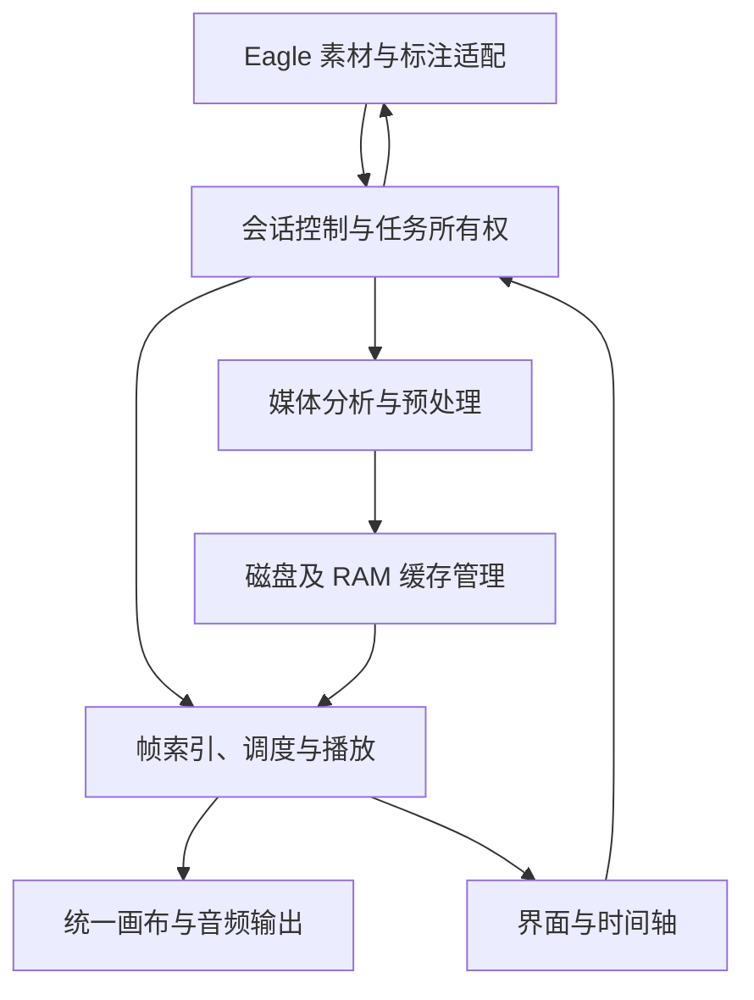
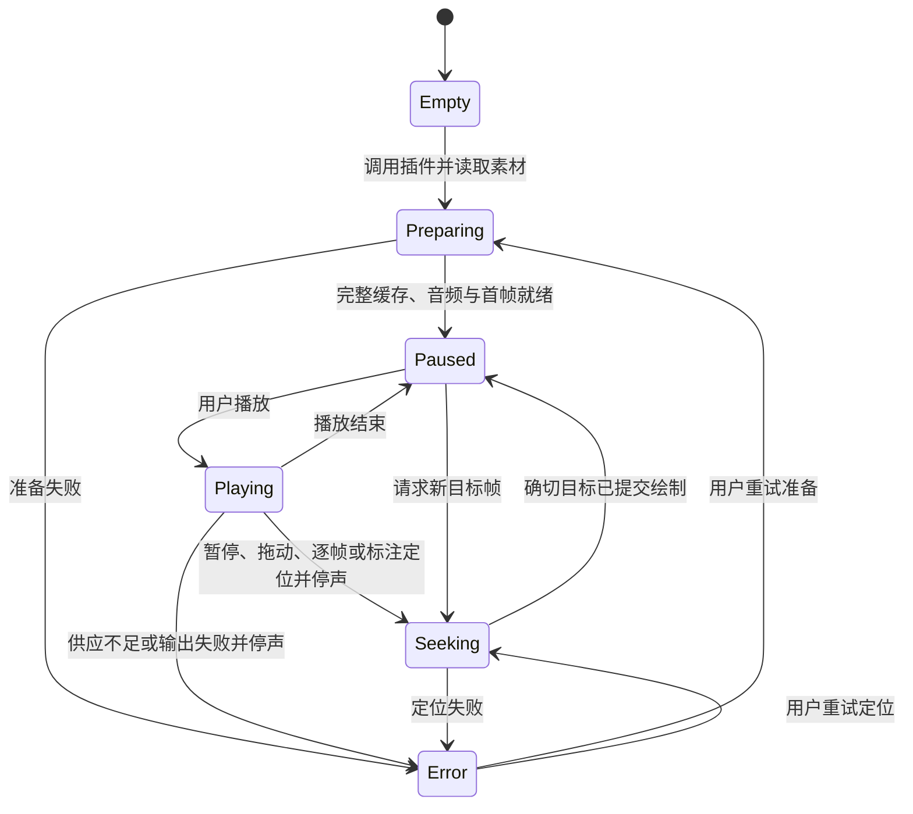

# 技术架构：阶段 3B 已批准

2026-10-20产品约束同步：以[当前产品定位与设计原则](product.md#当前产品定位与设计原则)指导后续设计。产品是“给特效师的播放器”，缓存、解码和资源预算是实现手段；模块与数据依赖不等于强制用户按固定流程使用工具。当前仍以plugin为唯一正式实现，本次不修改阶段3B架构、模块边界或技术选型。独立版及远期AI仅沿用既有愿景/计划边界，不新增实现或数据上传授权。

2026-10-20 E-10交互补充：同类命中/四角及箭头端点、无重做的有界历史和样式校验放drawing-model；瞬态空文字/拖动预览不混入已提交对象，drawing-ui只经Session发操作。drawing-session协调共享颜色/逐工具宽度及字号，drawing-store新增独立styles修订（color/widths/size，严格校验、默认懒读、原子提交），仍用现有owner协议；旧视频记录/visibility格式原样兼容，不重写旧数据。工具设置失败保留旧版并提示，不重建视频缓存。坐标换算使用CSS实际显示矩形，工具栏/属性与就地文本绝对定位不改变picture布局；侧栏只控制展开状态。真实文件/Session/DOM验证见[E-10报告](experiments/E10/report.md)。

2026-10-19 E-10实施边界：新增纯绘图模型、独立SVG透明绘图UI、Session协调与注入的永久存储；Eagle SDK仍只在eagle.cjs。annotation-data与cache/export-work分离，发布/Git排除。持久记录以库上下文+itemID隔离，绑定源SHA及源帧，不将平均FPS或请求时间当显示帧；更换源内容保留旧记录而不套新画面。不更改既有颜色/播放器/导出管线。持久化owner=eva-drawing-store-v1，严格字段/源帧与原生时间分开校验，以排他硬链接提交修订并保留最新两份，无长期写锁；文档和显隐配置均由drawing-store唯一读取/写入。绘图、移库/重载/关闭和未知删除均有保护，实际结果见[E-10报告](experiments/E10/report.md)。 详见[实施计划](experiments/E10/plan.md)。

2026-10-19：加速键V改为C，仅调整UI键位/帮助及测试；无Session/Player/缓存/偏好结构变化。上下视频要求读取Eagle当前视图及排序，公开接口不足以保证，内部读取方案经说明后用户明确暂缓；未引入该依赖或更改既有适配边界，详见[E-09记录](experiments/E09/report.md)。

## E-08追加实施边界（2026-10-19）

倍速校验/整数单位步进由Player公开纯辅助函数复用，UI仅通过Session调用setPlaybackRate；连续速率意图有界合并，沿Session/Player代次保护，不新增媒体队列或缓存预算。偏好仅追加可选rateStep字段，读旧值默认0.1、原子保存与文件边界不变；Session仅控制设置应用路径保留位置/范围/速度且不重建媒体。N及S/E复用按钮相同的Session入口和禁用/未知结果/目的地规则，不直接从UI访问素材或文件。具体结果见E-08报告，不把新的4×控制范围当成全素材性能通过。

## E-08时间轴显示边界（2026-10-19）

本轮按[E-08计划](experiments/E08/plan.md)在UI层统一可见时间映射、裁切和自适应刻度。循环真值及源帧定位仍由Session/Player负责；L显示联动、R编辑临时整段不修改源索引、缓存/导出范围或音视频时间。页面辅助模块按HTML顺序加载，不能用宿主相对require。拖动固定映射，显示范围切换只重画有限刻度、标注位置及既有绿条，不增加媒体任务/轮询或修改持久记录。具体检查与实际结果另记E-08报告。

区外标注关闭循环的追加批准在Player既有annotation定位中同步判断真实目标ordinal并关闭loopEnabled，保留端点；不由UI先await关闭再发定位，因此仍受同一次Session控制和Player代次取消保护，不会自动恢复播放或对新视频发迟到操作。transport新增只读endBoundary来自既有真实循环结束边界，供UI包含最后源帧；不新增缓存字段/格式或估算固定FPS。

## E-07源导出与标注完善边界（2026-10-19）

用户追加批准原生标注自动同步与Enter保存。Session拥有当前素材的只读串行读取/一个最新待载入请求、可见性和1秒调度；app仅接Eagle显示/隐藏，UI仅传窗口可见/返回事件及键盘操作。适配层仍独占SDK读取。初始/后台读取共用同一在途槽，15秒只报告等待，不假装取消SDK后重复派发；失败按2/4/8/16/30秒退避。隐藏停派发且丢弃后台晚到数据，关闭清调度/超时提醒、不等待不可取消的只读IPC；换片/换库由epoch及源ID/路径保护，最多保留最新一次载入读请求。无需媒体/缓存变更或新增持久记录。

比较ID/时间/文字/可用版本，未变保留原列表引用；同步保留草稿，原目标发生外部冲突时转为不可保存但可复制的状态。保存/核对前后增加写操作代次，丢弃写入前拍到的旧读取快照；当前素材的已发出/未知写入期间不自动读回判成功，仍须原只读核对流程。UI保护组合输入与刚结束的选字事件，冲突到达时不覆盖正在组合的文字；保存成功恢复时间轴焦点且不抢其他窗口或新素材的焦点。其余全局焦点策略留功能包3。

复用A-07同一守护/worker及既有串行队列；新增export/publishExport/discardExport控制请求只带当前lease、源帧ordinal/范围与目的地，不经IPC传图片/整段视频。export.cjs负责只读源文件、源SHA/身份复核、原尺寸PNG或高质量MP4、有限暂存与本地原子不替换发布；Frame/PCM缓存仍由cache独占管理，UI不增加文件/FFmpeg访问。新模块的输出职责仅限本次用户导出，不取得预览缓存或素材库任意删除权限。media只额外公开既有RGB换算，预览配方与缓存格式不变。

eagle适配层扩展官方文件夹读取、保存对话框、addFromPath及标注updateComment/removeComment；导入新取Item核对目标文件夹/名称/内容SHA，超时或响应丢失先读回、不重发。标注按ID及原文字/时间/可用lastModified版本预检，仅发送目标文字字段或指定ID删除；SDK未提供跨程序原子比较更新，不能承诺消除第三方恰在预检后改写的竞态。新增导入/改删的真实库写入测试仍需具体授权。

Session固定实际显示帧与已确认范围、暂停、管理可取消任务与已发出写入的区别，过期结果不恢复新素材/关闭UI。取消会等待原有任务组内FFmpeg退出和流关闭后清本次输出；保存已发往Eagle只能等读回/核对。已确认保存后的清理失败单独提示，不重复保存。plugin/export-work归属/每次job与结果独立，累计1GiB，未知中断保留，不能接入预览缓存清理事务或成为视频打开门禁。输出兼容/强退及实际宿主结果见[E-07记录](experiments/E07/report.md)；冻结Beta、A-01～A-08和已验范围不变。

## 当前演进范围与架构边界（2026-10-18）

用户确认后续主线按功能包推进：**1 导出当前画面/所选片段与标注修改删除 → 2 时间轴刻度、可读性与快捷键 → 3 自动半隐藏悬浮侧栏/设置及底部时间轴UI → 4 画质、准备速度、资源稳定性与兼容性 → 5 远期AI片段分析与节奏时间轴**。方向与依赖见[路线图](roadmap.md)，执行及集中验证见[开发计划](development-plan.md)和[验证协议](verification.md)。本次仅更新规划，不表示上述功能已经实现、验证或选定技术方案；下方既有架构与A编号决策保持。

继续维护plugin/唯一正式实现，UI经Session协调操作，素材库调用仍只由Eagle适配层执行，媒体处理、缓存文件管理、设置持久化及播放调度沿既有职责分离。后续导出与标注改删必须在这些边界内设计；导出来源/格式/位置、精确片段处理及标注并发更新等未协定行为在实施前及时沟通，不由本段选定实现或扩展素材库写入权限。界面重排不能把媒体准备、文件写入和Eagle API重新混入UI，也不因极简删除已要求保留的当前视频RAM信息。

局部放大与平移移出开发主线；附近原始像素预读仅保留候选，不等同于当前JPEG周围解压。整段无损暂停，拖动轻量/停下补高保真暂不开发。远期AI未选服务、模型或数据发送方式，不能视为获准引入依赖、上传素材或增加常驻后台。重大模块/持久格式/资源或测量边界变化按原规则先说明原因、证据及替代方案；遇重复失败或更优路径主动与用户商讨，不为赶进度默默变更。

功能包集中交付不改变内部按小范围检查的要求，也不将性能优化排后解释为延期处理数据安全、资源失控或影响正常使用的阻断问题。冻结MVP Beta及原始实验/发布记录不改写；下方旧日期的“下一步/待接入/未授权”仅对应当时，当前范围以上述路线和progress为准。

## E-06播放控制扩展（2026-10-18）

UX-01～03：提示在screen内绝对定位，控制栏不因编辑态换行，避免占用视频布局高度；滚轮只由ui在画面/时间轴接收并复用Session.step或选区step，不读帧文件或创建新调度。显示/输入设置沿preferences（4KiB原子文件）→Session快照→UI，新增wheelFrames/showCacheStrip两个可选字段，旧记录默认1帧/显示绿条，旧save调用保留当前新字段。正式文件读写仍只在preferences，Session转发统一应用；仅UI/绿条/主动解压且RAM/画质不变时暂停并原位应用，不重载Player或重置未变的预读。隐藏只停绿条绘制，缓存准备/范围/标注保持。封存原型/外部Beta不共享正式开发设置，不为本轮改写。

选区交互修订：loop-selection.js为UI层临时输入状态机，管理R短/长按、未确认端点和取消，不读文件/素材；ui.js仅做DOM/指针接线，经过Session调用Player.loopFrameAt映射真实源帧，再复用seek预览。双端确认调用applyLoopRange，一次性提交范围并从起点播放，不逐端修改正式范围；起点画面就绪前保留旧范围，会话/播放代次失效不提交、不续播。取消通过显示帧定位取代未完成请求，不能只调用不取消定位的pause。草稿不入偏好/磁盘，旧缓存/音频核心与模块依赖方向不变。

同一Player管理源帧范围、播放倍率和音画时钟；UI只调用Session，Session保护素材epoch/标注编辑，应用RAM或画质后按同源SHA恢复传输控制。循环按源帧end边界映射时钟，前向预读跨范围末端；原欠载停声、两图像槽和周围缓存预算不变。

沿既有Web Audio使用source.playbackRate与原生loop，不引入依赖或每轮重启进程/生成缓存。音频覆盖范围完整时复用原AudioBuffer；循环包含原音频前后静音区时才建立单个有界补静音缓冲，计入原Budget，在暂停/改速/改范围/换片/关闭时释放；绝不每次循环新增缓冲。视频与音频同倍率，偏移等待按倍率换算，不做保音调。循环后的时间映射仍以音频时钟为准，无音频用原单调时钟。

API依据：[Web Audio 1.0](https://www.w3.org/TR/webaudio-1.0/)、[AudioBuffer](https://developer.mozilla.org/en-US/docs/Web/API/AudioBuffer)、[原生循环](https://developer.mozilla.org/en-US/docs/Web/API/AudioBufferSourceNode/loop)。规范支持不等于当前Eagle真实音频验收，最后集中体验。

## E-04/E-05中心窗口调度修正（2026-10-18）

同一Player按实际源时间规划最近的连续帧窗口，保留原固定资源/压缩池/两个前台工作余量。后台仍最多一个任务，空闲时每次有限替换窗口外最远位图；当前显示/目标及近期播放供帧受保护。光标变化使旧计划失效，前台不等后台，固定中心不形成替换循环；关闭开关保留按需策略/已有位图。不新增进程、预算、磁盘格式或媒体处理。

细绿条显式object-fit:fill以覆盖视频canvas的contain继承；UI独立50ms采样，未变不画，尺寸只在初始化/resize重算，正常画面快照不扫描缓存。范围仍按真实帧时间、不跨越实际未缓存空洞。以上替代上一版仅向后填充及250ms采样实现，不改冻结Beta。

## E-04/E-05实施边界（2026-10-18）

沿用同一个Player/预算与两个图像在途槽；前台目标优先，额外铺帧最多一个任务且不得为铺帧连续淘汰旧帧。默认开启的主动准备在播放器就绪后执行，不阻塞首帧；JPEG预读也须让出前台任务，配置同一preferences原子记录。绿条只读Player的实际位图集合与源帧时间区间，UI不读取磁盘/像素，单独限频采样，不将整套位图状态塞进每次绘制快照。中断仍按原epoch/真实任务结束释放。新配置字段须兼容原百分比/额度/画质记录并验证保存重开；缓存磁盘清单不新增格式。


持久化新增forwardPredecode的唯一读写端为preferences，app创建Player时注入，session只改开关时就地暂停应用；兼容旧百分比/ramMiB/previewQuality记录，失败保存不得改变当前值。磁盘清单/像素版本不变。1080p H.264/VP9的filter_threads分别4/2，其他保持原值；依据见[E-04对照](experiments/E04/report.md#首次生成小对照)。绿条版本仅随位图新增/释放改变，UI独立250ms采样，普通画面快照不枚举位图。

## E-03 批准行为的实现约束（2026-10-18）

EV-10～12接入沿用现有模块、JPEG和停止交接架构：尺寸计算为纯规则，preferences持久化设置，session负责暂停/释放/恢复源帧，media生成对应尺寸，cache统一负责双档身份、5GiB计量、占用/清理/恢复，UI只提交设置。配置格式需兼容旧RAM/百分比记录；缓存新变体必须与旧720p隔离且仍可安全识别、盘点及清理，不能建独立预算或第二个任务负责人。具体实现与验证见[E-03记录](experiments/E03/report.md)；不改已发Beta，不重新选择渲染架构。

| 持久化内容 | 写入端与读取/恢复端 | 兼容与边界 |
| --- | --- | --- |
| memory-settings.json新增previewQuality | preferences单一原子写入/读取，app注入session | 旧百分比/ramMiB仍只读兼容；新格式旧代码不保证可读，代码回退不自动回退用户设置，外部冻结Beta不共享此文件 |
| manifest.preview及变体目录 | media生成，cache提交/复用/盘点，task-client跨进程接入，session/UI读取尺寸 | 老recipe字符串保留为所有权命名空间；新的尺寸规则版本＋档位生成不同目录后缀，绝非两个独立5GiB预算 |
| writer.previewQuality | cache.begin写入；recencyRepair/verifyReapRecord恢复最近使用事务 | 旧writer缺此字段按旧目录；新旧lease路径、清理计划/回执、根盘点均识别三种合法后缀，未知仍保护 |

双档不同时驻留RAM；切换仍先释放旧Player，再按同一RAM设置建立当前档。回退实现时须保留新格式识别/安全清理，不能直接用旧程序打开混有新变体的开发缓存，或删整个缓存来掩盖兼容问题。


2026-10-17 EV-09局部颜色缺陷修复，2026-10-18限定验收收尾：仍由media负责源转图、cache负责文件、player负责显示，不更换播放/缓存架构。颜色字段缺失时沿用Chromium108的SDR推断，显式字段优先；先形成RGB，再按JPEG601全范围编码；sRGB画布明确声明。manifest新增colorVersion，不改owner/recipe/锁格式；当前素材旧版本在核对清单/指纹/占用后使用现有事务清理重建，未知/在用保留，新原因obsolete-color-cache沿全部清理恢复入口读取。详情与限制见[Evolution收尾](experiments/Evolution/report.md#颜色专项最终收尾2026-10-18)。保留JPEG q3/420及Canvas；不采用实验captureStream输出、调色/锐化或精细JPEG默认。颜色前置关卡已解除，E-03具体规格已由EV-10～12确认，不修改已发Beta。

## 发布后重评边界（2026-10-17，历史）

本节保留当时的重评与实验边界；整段无损暂停、E-03接入及后续实现以本文上方已采用记录和当前范围为准，不据本节重新启动旧实验。

已发布实现仍为C及A-01～A-08，不因[路线图](roadmap.md)讨论改变技术选择。用户当时批准优先验证整段无损预览、保留有损轻量方式及条件成立时的模式选择；后续已授权E-01/E-02隔离实验，结果见[实验记录](experiments/Evolution/report.md)。当时正式实现未改，尚未选择PNG/WebP作为正式格式、修改正式缓存格式或批准E-03接入新的播放链。

E-02比较同一源帧、尺寸和颜色输入的编码质量与资源；E-03前依据结果明确处理配方、源帧映射、格式/尺寸/方向/色彩标识、旧缓存读写/清理兼容、设置及资源分配。当前生成/校验/读取的JPEG和720p假设需完整盘点，不能只改扩展名、像素尺寸或RECIPE常量；旧记录不认识新格式时不能靠全删缓存回避迁移。继续沿用窗口/后台交接、唯一素材API入口和帧调度边界，无证据不大规模重构。

如果实际选择新的无损编码或双画面来源，再新增正式架构决策，包含收益、代价、回退及批准状态。当前“停下补高保真”及附近原始帧预读仅候选，不是新的A编号决策；后者可局部缓存源解码像素，与当前JPEG相邻帧预读不同。公开AE/PR实践支持思路，不证明Eagle实现、缓存算法或性能达标。较高画质的RAM配比/预算与性能必须实测，不从像素数或文件压缩比直接外推。

## 已发布架构与演进历史

2026-10-16随后HEVC模块内优化：真实只读管道的1/2/4缩放并行度比较显示4线程更快且全部JPEG/PCM/PTS摘要不变，因此仅HEVC缩放1→4，输入8/编码2及H.264/VP9原参数保持。不是增加视频并发、RAM额度、降画质或改变架构；完整窗口随后在喜多郁代三组首次/复用及实际Canvas核对限定通过，见[结果与边界](experiments/T4/report.md#2026-10-16-hevc完整准备与实际画布核对通过)。三种代表编码完整P-03已补，当时后续计划新后台长期验证，现按批准的短回归/长期待验边界收尾，未因此宣布整体架构资源验收通过。

2026-10-16模块内修复：stream声明结束不晚于末帧PTS时，media用同一解码管道显式末帧duration定末尾，缺少可靠duration报错，不按FPS猜；正常有效声明/旧完整缓存规则不变。Player暂停时前后各3帧预读、优先最近逐帧方向，仍一个后台槽、两个图像任务及原RAM账本。UI经session发逐帧请求，帧数取实际已提交ordinal。用户批准【/】及当前/总帧数，见product；属于既有C/A-08内修复，不另选架构。证据/反馈及未验边界见[T4记录](experiments/T4/report.md#2026-10-16-末帧边界修复与逐帧体验)。

架构基线：v1，2026-10-10。用户批准本对话中的“3B 最终架构总审版”，并在批准前修正缓存目录为**实际插件目录下的 cache，完整和临时缓存均不得位于 C 盘**。本文件落实批准结果；产品行为以 [product.md v1 及已批准补充](product.md) 为准，阶段状态见 [progress.md](progress.md#阶段-3b-架构收尾)。

本次批准的是设计与验证边界。3C 的[测试协议](verification.md)与[开发计划](development-plan.md)已获用户验收；2026-10-11 用户另行整体授权阶段 4，当前从 T0 建立可复用核心与独立测试入口。正式缓存管理、有限并行性能、淘汰、锁及异常恢复仍以实际验证记录为准；旧原型和原始证据保留，不改变架构 v1 或 A-01～A-03。

2026-10-11 用户批准的空格播放／暂停、拖动时间数字和极简主画面与侧栏属于界面补充：沿用 UI → 会话 → 播放的数据边界，时间提示读取实际已提交帧，输入保护及验收在上述 3C 文档中落实。常驻秒刻度后续再考虑，媒体、缓存、音频方案及下方已批准架构核心保持不变；3C 完成条件自查见 [进度](progress.md#阶段-3c-交互补充与最终自查)。

## 总体方案与决策依据

2026-10-11 采纳补充 A-04：用户完成三项短对照及两候选人工操作，明确认为流畅度合格、批准采用并继续阶段4。依据同素材完整短记录，采用 `compressed-ram`：最多64MiB的已校验JPEG预载池与解码图像、音频、复制/在途资源共用512MiB。仍仅在rAF提交最新目标，不叠加`ready-submit`。本素材全池60.87MiB，其他素材允许部分覆盖；超出池容量的图片仍经受限磁盘读取。池在首帧就绪前准备，成本纳入P-03，切换/退出等待真实任务后释放。正式UI无模式开关。证据与局限见[T0采纳记录](experiments/T0/report.md#两项对照核对与用户人工验收)。短对照和用户体验验收不替代正式多轮量化关卡；下段保留此前试验授权的历史状态。

2026-10-12，T1修正部分覆盖时的池内替换实现：首备仍在原预算内预读；后续经受限读取及内容校验的JPEG，在真实解码结束、在途预留缩减后进入同一字节计量池，按最近使用替换。已完成读取但目标过期且未进入解码器时，同步转移该读取预留并保留JPEG，不执行过期绘制；跨素材仍先失效任务。保持≤64MiB、合计≤512MiB、两个图像任务及rAF提交，不更换格式或提高预算；首次访问未驻留帧仍需读取及解码，不承诺全段即时命中。[本轮修复与诊断](experiments/T1/report.md#完整缓存关闭与后段拖动修复)区分实现回归、独立浏览器测量和Eagle人工验收。

T2额外UE素材回归发现首轮部分覆盖的连续冷尾段：在A-04原预算/数据流内调整预读集合，优先首末帧，再逐层细分帧区间，按实际字节纳入；选定后按源顺序读取。整段能容纳时仍顺序全载，不等大小或过大单帧不突破容量。此为池内选择的实现调优，不保证未覆盖帧即时读取或改变VFR时间映射。会话只读快照另直接取当前就绪Player，避免后台任务结束后诊断仍持有旧资源状态；切换/关闭代次保护保持。旧真实失败、模型检查及新宿主待验见[T2专项记录](experiments/T2/report.md#新增真实宿主回归失败与定向修复)，不将代码完成写成性能通过。

T0试验补充（2026-10-11用户批准）：在512MiB内分别对照压缩JPEG内存池与就绪受控提交；后者仅在显式试验模式下可偏离基线仅rAF提交。默认及正式架构选择不变，尚未取得宿主改善/正式采纳结论。范围、测量差异、回退与证据见[T0定向对照](experiments/T0/plan.md#待审定向对照固定512mib区分读取与提交时机)。

采用 C：**统一 720p JPEG 缓存画面 + 实际 PTS 帧索引 + PCM 音频 + Web Audio 音频输出时钟**。自动准备整段素材，完成后显示第一帧并暂停；播放、拖动、逐帧和标注定位使用同一 Canvas（画布）。JPEG 在磁盘保存，读取后仍需解压为像素，已解码图像放入有上限的 RAM 缓存。

保留 Windows Eagle Window 环境、HTML/CSS/JavaScript、Node 内置模块和现有 FFmpeg/ffprobe；不新增 TypeScript、前端框架、构建工具或第三方依赖。兼容已测 Eagle Node 16.17.1 / Chrome 108，缺少现有媒体工具时提示，不自动安装。

预处理沿用 S1 已验证的一次视频解码链，同步生成 JPEG 与 PTS 索引；音轨按共同时间关系提取为 PCM，不为索引和图片分别重复解码视频。

以下是本文件内的核心决策记录，统一保留问题、候选、证据、推荐、风险和重评条件，不另建重复 ADR 文件。

| 决策 / 问题 | 候选及取舍 | 已有证据与正式选择 | 风险 / 重新评估条件 |
| --- | --- | --- | --- |
| A-01 播放、音频和逐帧如何统一 | 原视频播放 + 缓存分析可复用浏览器播放，但需处理两个画面来源和时间切换；C 共用画布，帧身份统一，但增加图像解码、调度和音频时钟责任 | S1 已在真实 Eagle 输出缓存画面/音频，用户本次未观察到不同步；采用 C | 慢解码可能长时间无更新；完整声画/编码验证不达标且无法解决时重评，不静默改为普通播放器 |
| A-02 缓存格式 | JPEG 可独立访问每帧，已有测量；WebP 值得比较压缩率与解码成本，但无本项目数据；全帧内视频仍需解码和准确取帧验证 | 采用 720p JPEG，q=3 为初始内部参数；不维护多策略框架 | JPEG 有损且仍需解码/上传画面；颜色、细节、生成或播放成本不满足验收时，先定位瓶颈再重评格式 |
| A-03 资源与取消 | 全帧解码常驻 RAM 容易超预算；保存残缺结果以续建增加完整性和恢复复杂度 | 采用持久完整缓存 + 有界 RAM 淘汰；未完成任务取消后清理，下次重建，完整有效缓存复用 | 正式淘汰/锁/恢复尚未实测；无法容纳时明确失败，不放宽预算、误删或后台继续旧素材任务 |
| A-04 拖动读取与提交优化 | 分别比较原基线、压缩JPEG驻RAM、就绪受控提交，不叠加 | 2026-10-11用户人工认可并批准采纳；同素材短测压缩池86.33有效观察/秒、最长34.90ms，采用最多64MiB池且共用512MiB，保持仅rAF提交 | 预载增加准备成本，其他素材可能仅部分覆盖；完整多轮/P-03和正式UI回归仍待验，不以短测认定全项性能通过 |

预览保留画面比例、方向并处理色彩元数据；帧身份与 JPEG 压缩产生的视觉差异分别验收。特殊色彩/HDR、高位深、复杂 MP4 编辑时间线等列入验证风险，不据此擅自增加产品输入硬限制。

## 模块、依赖与数据流

### A-06：固定RAM档位与空写锁恢复（2026-10-14）

用户随后确定完整缓存闲置1天自动清理及侧栏“清除其他视频缓存”，独立设置页留后续。begin在恢复/盘点后，沿原排他事务与cleanup-plan/result链执行过期清理；当前target和全部有效lease保护，未知/未来最近使用时间保留。clearOther经session暂停/固定当前sourceSha256后调用同一事务，清理其他可安全处理的完整缓存。先核对全根、全部候选及清单/回执空间再删除，仍计5GiB，不能删除缓存来腾出自身清理记录空间；清理中断沿原计划恢复。不存在插件未运行时的定时后台删除；实际在下次载入/重试触发。最近使用记录由成功复用/发布touch更新，lease存续期间始终保护，不以磁盘mtime代替使用记录。

用户明确将A-05百分比设置改为512MiB及1～10GiB下拉档位，默认1GiB；preferences保存owner/ramMiB，只读兼容旧percent并提示最接近档位。UI经session.setMemoryMiB调用；旧暂停/固定当前素材与时间/等待真实释放/重载/保持暂停和1/8池比例不变。高额度仅为可选配置，不代表已测性能或允许改变测试观察停止线。

再次发现0字节writer.lock；旧begin在创建空锁后先usage扫描再写归属，存在较长匿名窗口。新begin立即写入并fsync完整owner后才盘点。既有空锁由process-identity的Windows FileShare.None独占句柄核对最终路径、卷号/文件ID、单链接普通文件和0长度，再在同一独占句柄内写入本事务完整归属。无当前进程身份、不支持平台、共享冲突、非空或身份改变均不能接管；年龄不是依据。接管后沿原写事务、预算和退出清理；不删除完整缓存、不取消跨窗口互斥，不清除未知非空/恢复锁。实现与真实Windows文件检查记录见T2报告，实际Eagle退出/重开仍须当前候选验证。

### A-05：用户确认的可调RAM预算（2026-10-14）

用户确认缓存额度为整机物理RAM×百分比，JPEG池上限随总池按1/8同比扩大；在1GiB/128MiB真实宿主六轮通过后，另接受默认等效1GiB、修改后暂停/保留位置/重新准备/保持暂停、设置持久化。此变更取代A-04固定512MiB/64MiB数值，其JPEG格式、rAF最新目标守卫、两个图像任务、整段缓存及磁盘路径策略不变。百分比自然范围0<p≤100，字节向下取整，池实际用量仍登记在同一账本，账本不计浏览器/GPU/辅助进程内部开销。

新增preferences.cjs仅管理本地设置及os.totalmem换算，不访问Eagle/素材库/缓存资产。app装配设置能力并向Player注入每次额度；UI仅经session.setMemoryPercent提交操作。session先校验/暂停，保存成功后固定当前素材/已显示时间，走现有取消/释放/媒体验证/Player载入流程，再精确定位并保持暂停；不选择另一素材、不修改源或标注。原磁盘完整缓存正常复用校验，此实现可能等待，不能承诺设置即时应用或秒开。配置仅plugin根memory-settings.json（owner＋percent，≤4KiB），同目录唯一next文件wx排他、fsync/身份核对后rename；异常保全既有设置及未知占用，不清除缓存。范围变化和资源释放失败沿原会话门禁处理。设置作用于本机所有后续视频，默认不自动写文件，用户应用时持久化。

1GiB单素材通过不代表可调设置/高额度/高画质全通过；1.5GiB真实宿主观察线仍为测试保护，测试更高预算需独立核对执行边界。原512MiB、旧阶段证据不改写。新增设置及当前新源码须独立Eagle验收。

以下是逻辑职责，不要求各自拆成目录或引入复杂框架。文件拆分与测试任务已经 3C 确定；阶段 4 按 development-plan 逐步实现，当前 T0 仅建立必要核心及独立验证入口。



| 模块 | 输入 → 输出 / 职责 | 依赖边界 | 失败与验证重点 |
| --- | --- | --- | --- |
| Eagle 适配 | 选中项 → 素材身份/路径；标注读取、添加及独立读回 | 仅本层调用素材/标注 API；结果交会话控制 | 空选、多选、权限、API 失败、结果未知；真实 Eagle 单独验证 |
| 会话控制 | 用户操作 → 播放状态、素材快照、目标及任务令牌；汇总错误与资源生命周期 | 调用适配、准备、缓存、播放；UI 不越过本层写数据 | 旧回调、库变化、切换/关闭、标注竞态；状态与事件顺序检查 |
| 媒体准备 | 只读源文件 → JPEG、音频、索引与完整性清单 | 使用现有工具，经缓存管理受限写入，不自行淘汰文件 | 超时/退出异常、原文件变化、时间信息或输出不完整；合成预期值和实际媒体检查 |
| 缓存管理 | 内容键/资源请求 → 有效资源、预算账本和释放句柄 | 使用 Node 文件能力；不调用 UI/素材写入；向准备和播放提供资源 | 配额、锁、残缺缓存、未知文件、越界；容量故障与安全清理检查 |
| 播放与帧调度 | 时间/源帧目标、音频时钟 → 当前帧、画面提交和状态快照 | 读索引与缓存，使用 Canvas/Web Audio；不调用标注 API | 过时结果、慢解码、音频偏移、欠载；独立画面参考、日志及人工声画观察 |
| 界面 | 状态/标注 → 显示；输入 → 用户操作 | 仅向会话控制发操作，不直接写文件或调用标注 API | 未就绪误操作、错误反馈不明确；接线检查与真实操作 |

最小关键数据：素材快照保存库上下文代次、itemId、文件路径及内容身份；帧索引保存呈现编号、原始整数 PTS、时间基准、显示区间与缓存文件；缓存清单保存处理版本、源内容指纹、帧/音频信息、文件清单与完成状态；请求保存会话代次、目标帧/时间、请求号与原始输入时间。整数 PTS 持久化须避免 JavaScript 数值精度丢失，不能只存平均帧率。

关键拖动数据流：鼠标原始输入 → 会话固定素材/请求 → 索引选择目标源帧 → RAM 命中或有限读图解码 → 绘制前再次检查最新目标 → drawImage 提交 → 更新已显示帧和 UI。分别记录输入、目标就绪和提交时刻。

2026-10-15模块内优化：同向连续拖动用最近最多5个目标时间估计下一目标，避免直接重复末次帧取整步长而反复预取邻帧；预测仅占原两个图像任务之一、从实际PTS查帧，换向/停顿/释放清除旧轨迹，真实目标及绘制守卫不变。H.264输入解码最多8线程、缩放2线程，JPEG编码仍2线程；HEVC/VP9原参数不变，单视频任务、输出配方及缓存键保持。真实索尼克管道的图片/音频/时间信息摘要一致，后续同素材/default1GiB六轮真实短回归通过；用户批准沿用既有体验验收，完整首次P-03仍未通过。同步小JPEG预载因实际变慢撤回，正式读图接口不变。详见[T4收尾](experiments/T4/report.md#2026-10-15-最后一轮真实短回归通过与体验验收复用)，不是新架构决策或全样本/全部P项通过证明。

原型复用评估：A/B 的 Eagle 调用边界、特殊路径处理与独立读回，S1 的实际帧索引、受限写入、音频偏移和提交守卫可作为正式模块的复用依据；对应合成输入与证据继续作为回归参考。实验 UI、硬编码路径、授权文件、实验上限和测量接线不直接作为正式产品流程；会话组织、并行预取、正式淘汰/锁/恢复须按本架构整理与验证，不覆盖原 prototypes。

## 播放状态、索引与调度



切换素材、库变化或关闭适用于所有状态：先使旧会话/播放令牌失效并停止旧声音；切换等待旧生成任务停止后准备新素材，关闭释放当前资源。Preparing 禁止播放/拖动；Seeking 未完成前不能依据尚未显示的目标播放或添加标注。标注输入和提交状态由固定提案管理，不能用播放状态替代写入状态。

- **源帧映射**：按实际呈现顺序和 PTS 建立显示区间，时间定位查区间，逐帧按相邻编号；保留首末帧、音频尾部和共同时间原点。相同时间戳的帧仍保留各自编号；时间定位使用确定规则，逐帧不得丢帧。缺失/矛盾信息无法可靠恢复时说明失败，不用平均帧率猜测。
- **音频协作**：有音轨时采用 Web Audio 输出时间估计驱动画面，保留实际解码的音频偏移；无音轨时使用单调时钟。数字静音的音轨不等于没有音轨。音频先结束时媒体时钟继续；暂停/拖动/逐帧先停声，恢复从已确认帧时间开始，旧音频结束回调不能影响新播放。
- **最新目标**：每次浏览器刷新合并输入，同帧复用已有工作；每次提交前同步核对库/素材代次、当前目标与请求身份。过时结果可在预算内留作缓存，但不得提交画面；被替换请求明确结束，不悬挂 Promise。
- **有限并行**：只针对同一视频，最多两个 JPEG 读取/解码任务在途、一个最新待处理目标；优先级为最新目标、播放前瞻、邻帧预取。预取受预算和窗口限制，不能占满当前目标资源。全局视频预处理仅一个任务，不同时生成两个视频缓存，也不继续旧视频后台完成。
- **释放与欠载**：释放后稳定目标获最高优先级，实际提交后才进入 Paused 并允许播放/标注。正常播放供应不足时停止声音并说明问题；S1 的 150ms 是实验保护阈值，不作为已批准的产品性能豁免。

并行、预取和 RAM 命中只能作为缓解慢解码的设计，尚未实测证明消除饥饿；目标持续变化且处理持续较慢时，仍可能没有新画面提交。不得提交旧目标来凑更新率，须保留连续更新、最新目标与末次准确性的联合验收。

## 缓存根目录、容量与生命周期

正式目录为 **实际 `plugin.path` 下的 `cache/`**，无需用户设置页；路径发现沿用已验证的启动事件，不从页面 URL 反推磁盘目录，也不依赖未验证的 userData API。

启动/写入前解析实际路径，核对与插件同盘、实际目标非 C 盘、可写、空间和插件所有权；完整缓存及 partial/临时文件都留在此根。插件本身位于 C 盘时提示先迁至非 C 盘，目录不可用时失败，不回退 AppData、C 盘或系统 TEMP。本次不创建该目录、不迁移插件；S1 runtime 原位置和限额保持原样。源视频和既有工具的所在盘不由“缓存非 C”要求扩大限制。

| 环节 | 已批准规则 |
| --- | --- |
| 身份与复用 | SHA256 + 处理版本为内容键；版本涵盖画质、尺寸/方向/色彩、音频和时间映射。同内容可复用画面，但 itemId、路径、库上下文与标注独立绑定；源内容变化后重建，仅重命名尽量复用 |
| 准备与提交 | 单生成任务，排他锁覆盖重复窗口/进程；先在同根临时目录受限写入，完整校验帧/音频/清单，再以同盘目录 rename（重命名）原子发布完整缓存，避免逐文件复制暴露残缺结果。全局索引可由完整清单恢复，残缺缓存不参与播放 |
| 磁盘预算 | 5 GiB 计入完整与临时产物、JPEG、PCM、索引及清单；写入前预留，按最近使用记录淘汰最久未使用且未占用的缓存。保护当前素材和在途任务；无法腾出空间则说明失败 |
| RAM 预算 | 512 MiB 计入已解码帧、音频、压缩读取缓冲、复制和在途预留；保护当前帧/目标，淘汰旧图像时释放对应资源。不可取消的已开始解码占额至真实结束，不提前虚报释放 |
| 正常取消 | 失效令牌、停止并等待 FFmpeg 和流退出，再清理本任务未完成文件；下次从头重建，不做断点续建。已经完成且有效的缓存保留供跨次复用，直到正常淘汰 |
| 强制退出与恢复 | 不能保证退出瞬间清完；下一次启动只回收所有权与任务终止均可确认的残留。陈旧锁处理保守，不清理其他活跃任务，不借恢复删除完整有效缓存 |
| 删除边界 | 核对所有权标记、实际路径和文件清单；不跟随链接，不删除未知内容或越界路径。遇不确定内容停止该项清理并提示，不为满足配额强删 |

插件/Chromium、FFmpeg、GPU 总内存另采样；512 MiB 是登记缓存数据预算，不保证总进程内存低于它。诊断/性能记录单独有界，不把 S1 的 32 MiB 证据上限作为正式产品缓存额度。容量故障、并发锁、崩溃恢复及目录可写性须在正式实现后验证。

## Eagle 与标注边界

启动及再次调用取得单选 MP4 的 ID/路径快照，复用已有窗口；仅改变 Eagle 选中项不换片，不扫描库。读取路径要覆盖中文、空格和特殊字符；缓存身份不替代当前素材身份。

载入读取标注并映射到同一时间轴；点击标注停声定位。添加时暂停，固定库上下文、itemId、**实际显示帧及其源时间**和文字；不能用尚未显示的请求时间。用户主动保存后调用一次 API，并独立读回核对。

写入区分成功、明确失败和结果未知：成功才显示已保存；失败/未知保留输入，不自动重发；未知结果恢复或再次保存前先核对原尝试，避免重复标注。已发出的 API 写入不能假装被取消；切换后旧结果不得更新新素材界面，仍按原提案身份完成核对。

素材、原文件和标注属于 Eagle；缓存、索引、处理清单属于插件；未保存文字、当前目标和任务令牌属于临时 UI/会话状态。原MVP将修改/删除留给Eagle，外部修改下次载入读取；开发版E-07已扩展官方SDK改删/独立读回及上述可见窗口自动同步，冻结MVP行为不改。不保证Eagle原生界面自身的即时刷新，不引入原生播放位置同步。真实库写入测试继续使用专用素材及具体授权。

## 需求覆盖、证据与后续验证

| 需求 | 架构机制 | 已有依据 / 待验证边界 |
| --- | --- | --- |
| R-01 | Eagle 适配、窗口复用、素材快照、会话代次 | A/S1 支持单素材读取；正式再次调用、窗口复用和切换隔离需验收 |
| R-02 | 帧索引、共同时间原点、音频时钟与明确播放状态 | S1 合成条码及用户同步观察；真实源帧独立参考、显式逐帧和全部边界仍需验证 |
| R-03 | 最新目标守卫、有限并行、RAM 缓存、释放后提交 | S1 所测脚本未见旧请求覆盖且最终目标达成；新并行/预取及慢解码饥饿仍待验证 |
| R-04 | 自动整段 720p 准备、就绪门禁、统一画布 | S1 自动准备和首帧暂停；正式极简流程及完整首次等待需验收 |
| R-05 | 标注读取/时间映射、固定提案、单次保存和独立读回 | A 一次专用添加/回退支持 API；正式与帧状态结合、未知结果/切换竞态需验收 |
| R-06 | 内容键、完整提交、5 GiB/512 MiB 预算、淘汰/锁/取消恢复、非 C 根 | 本地 S1 有受限写入与取消证据；正式目录、淘汰、锁和崩溃恢复尚未实测 |
| R-07 | 现有 Windows Eagle/工具链、实际 PTS，≤30 秒 MP4 | 已测合成 H.264/H.265/VP9 及真实 HEVC；完整最高 4K/60fps 首批矩阵未覆盖，不继承实验硬上限 |
| R-08 | 明确失败状态、源文件只读、所有权删除、固定标注身份与未知结果处理 | A/B/S1 有部分依据；正式资源不足、异常退出和标注竞态需故障验证 |

性能基于 [S1 实际窗口报告](experiments/S1/report.md#真实窗口证据与用户人工验收)，不重复生成报告或重跑实验。S1 的用户反馈独立保留为“本次未观察到不同步”；合成条码核对不作为真实素材像素准确性证明。

| 指标 | 测量机制 / 起止 | 已有支持 | 待验证与瓶颈定位 |
| --- | --- | --- | --- |
| P-01 更新率 | 播放层按实际 drawImage 提交统计，另记刷新机会；不能用输入频率代替 | 真实 HEVC 0ms 注入轮 61.77 次/秒 | 25/60ms 压力轮 32.39/18.04 次/秒，最长无提交 180.3/444.2ms；分查读取、解码、调度及绘制，不称已解决 |
| P-02 响应 | 原始输入至目标画面提交，包含该已完成请求排队；分记图像就绪 | 同一 0ms 轮完成请求 P95 8.0ms | 同时报告被取代/未完成请求、最长无提交、最终请求及人工跟手；提交不是物理呈现，不能用条件 P95 掩盖停顿 |
| P-03 首次等待 | 会话收到加载至音频/索引/首帧可用；分记读取/哈希、分析、生成、浏览器初始化 | 真实 HEVC 首次 2478.2ms / 10.031 秒，所测合成首次也满足相应目标 | 首次生成与复用分开；原 4K 只有复用窗口记录，完整 4K/60fps 矩阵仍待测。Eagle 回调前启动不冒充已测 |
| P-04 资源 | 缓存层连续预算与容量记录；另采样插件/FFmpeg RSS，注明进程/时间窗口 | S1 受管峰值 510.06MiB，插件 RSS 观测峰值 737.46MiB，最长单会话采样约168秒 | 正式5GiB淘汰/耗尽、长时拖动/切换、关闭/崩溃恢复需验收；账本不等于RSS，采样不保证捕获全部峰值 |

3C 已将以上模块边界、状态不变量、数据结构及测量起止映射到[测试协议](verification.md)和[开发计划](development-plan.md)：独立编号帧与真实参考、VFR/首末边界/音频偏移、相同目标压力对比、源内容变化与重命名、锁/取消/残留/容量故障、标注未知结果和长期资源趋势。用户于 2026-10-11 批准性能协议及真实样本优先原则；具体阈值集中在验证文档，不重写本架构或产品目标。3C 已结束，阶段 4 来自后续整体授权，按 T0 技术关卡开始执行。

若后续不能满足产品目标，先依据阶段计时定位瓶颈并重新评估架构；不得自行降低画质、丢失源帧、取消声音、扩大产品硬限制或改成普通播放器。3B、3C 已完成，阶段 4 来自用户后续独立授权；执行状态与真实验证见 progress 和各任务记录。

## 既有 A/B 原型架构（历史说明）

以下保留已存在 PoC 的文件与数据流说明。它解释历史实现，不表示该原型已经实现上述正式架构。

```text
Eagle → manifest.json → index.html
                           ↓ 启动事件
                        app.js
                  素材、播放、标注、证据保存
                           ↓
                    experiment-b.js
                  队列、画布、计时、资源采样
                           ↓
                       cache-b.cjs
                  ffprobe / FFmpeg / PTS 索引
                           ↓
                帧缓存目录与本机 evidence/
```

| 文件 | 职责与主要入口 |
| --- | --- |
| manifest.json | Eagle 窗口入口；插件 ID 保持原身份，名称不再绑定 A |
| index.html | A/B 实验控件、video 播放元素与共用 canvas 画布 |
| app.js | eagle.onPluginCreate 启动；loadSelected 读素材；seek 定位；标注授权保护及证据保存 |
| experiment-b.js | init 接线；LatestQueue 控制请求积压；render 显示帧；save 保存测量 |
| cache-b.cjs | probe 读编码/PTS；build 提取 JPEG；frameAt 按时间戳选帧；cleanup 安全清理 |
| check.cjs / check-b.cjs | 本地与合成输入验证，不代替真实窗口 |
| assess-b.cjs | 复核已保存窗口证据，verify-only 不写新评估 |

HTML 放置控件，JavaScript 响应事件；Node 内置模块负责本机文件和子进程，FFmpeg 负责视频解码/帧提取。PTS 是帧的呈现时间戳。

直接模式让 video 寻帧后绘到 canvas；缓存模式读取并解码 JPEG 后绘到同一画布。两者共用请求队列，只有一个在处理请求和一个最新待处理请求。

Eagle 启动事件的 plugin.path 用于核对磁盘目录；app.js 的批准路径已更新到新原型位置，迁移时不扩大加载范围。页面 URL 可能不是 file 协议，不能据此反推目录。

原生播放进度不参与同步。标注数据读写、自定义播放器操作和原生界面刷新分别验证。像素级帧准确性、缓存长期策略、完整内存管理尚未完成验证，见 B 报告。

当前实现基线仍为批准的C及A-01～A-08；MVP已按限定范围发布Beta2并冻结，用户已完成独立安装验收。长期内存/完整矩阵限制保留，状态见[Beta2记录](releases/v0.1.0-beta.2.md)。本轮仅同步整理和状态，不重新选型。R2长路径最小修复仅给Windows native realpath传扩展路径，原规范路径比较、归属及链接保护不变。

以下日期进度是历史，待验证安排以当前发布记录为准。

## A-08 JPEG集中存储与批量预载（2026-10-16）

用户授权首次准备优化，先隔离对照，实测有收益后接入。两组正序/反序对照均改善媒体准备及压缩图片预载，采用以下存储布局；产品要求、A-01时间索引、JPEG-q3/720p、PCM、A-07关闭交接、默认1GiB及1/8压缩池、5GiB磁盘上限不变。后端数据见[T4报告](experiments/T4/report.md#2026-10-16-首次准备优化jpeg集中存储与批量预载)。随后真实Eagle索尼克/720p/默认1GiB完成三次首次＋三次复用，完整readyAt计时限定通过，范围与副本/采样局限见[实际结果](experiments/T4/report.md#2026-10-16-索尼克完整准备计时限定通过)；其他素材/独立帧参考/长期资源不外推，此为验证状态更新，不改架构决定。

- 新生成缓存将原JPEG字节顺序写入`frames.pack`，不再次压缩。`frame-pack.cjs`只校验布局；manifest仍为schema=1/同一编码recipe，增加可选`framePack:{schema:1,file,bytes,sha256}`，逻辑帧增加offset并保留原长度、逐帧SHA和PTS。偏移须安全整数、连续、无重复/重叠/空洞并完全覆盖包；物理资产和逻辑帧分别登记。旧完整散图继续原样校验和复用，不自动转换；同根不同素材可使用两种布局。
- media写帧→cache写包/完成实际磁盘指纹核对→完整校验/原子发布→worker登记lease→窗口本地读取。session绑定原登记句柄，Player无需知道物理路径。`readAsset`继续按逻辑帧返回JPEG；可选`readFrameBatch`一次读连续且已登记的≤1MiB范围，各帧单独校验并返回独立缓冲区，不把大文件整体读入RAM。包文件受磁盘总上限约束，单帧仍受原256MiB安全上限约束。
- Player仅在准备时按连续帧批量预载，单批原始读取和返回副本均提前记入同一RAM账本；JPEG池上限不变，帧淘汰可独立释放底层存储。任务仍纳入原≤2在途槽、代次守卫和真实I/O完成门禁；拖动/播放/音频调度规则不变，超过单批的合法帧回到单帧读取。
- 盘点、复用校验、租用、手动/过期/容量/损坏清理、取消、普通残留恢复及已停止Job恢复均按物理资产处理。包流关闭后才允许清partial/交接；系统已证明旧任务组停止且归属/目录/文件清单一致时可恢复已知frames.pack，未知文件继续保留报错。不以缓存年龄判断任务死亡。
- 回退优先反向提交本轮写入/预载变更，同时保留新布局只读/清理兼容；直接运行不认识图片包的旧代码会拒绝新缓存，不能称无条件git切换即可恢复。若要完整退到旧格式，应另列精确新布局缓存清单并按原安全清理流程处理，不删旧完整缓存或源。当前未执行回退/转换。

只改正式plugin和必要接线/指纹检查，原生守护源码/二进制不变；没有发行新包。未来打包须包含frame-pack及已有任务守护模块，旧冻结展示包不自动更新。源码、模型、真实Eagle Node/Windows隔离媒体验证各自列证据，不能用后端计时冒充实际窗口完整就绪。

## A-07 任务生命周期与快速关闭交接（2026-10-15 用户批准整改）

问题：普通writer文件可残留；starting尚未登记身份永远拒绝恢复；关闭中run被丢弃；取消的真实清理错误可被superseded吞掉。2026-10-15实际545B writer（SHA5119d1bcaa189723f3f7212dfbed056ecc040eedd08b1b2231ba79c35e91058e）父PID19956已不存在、子记录starting/identity=null、系统快照无FFmpeg；实际拒绝原因missing-process-birth-or-child-registration，不是容量或RAM问题。

决定：由插件自有短生命周期任务负责人统一持有缓存变更权限并启动/停止媒体子程序，窗口与它通过本机管道通信。Windows命名互斥承担真实跨窗口独占，Job Object统一控制本次辅助进程，硬盘账本仅描述/恢复状态。启动子程序前即纳入任务组，不能留下先运行后登记的空档。负责人异常结束后，新负责人须确认前任务组停止，才处理旧记录；不得只凭获得锁就删文件。只结束归属本插件任务的程序，不结束Eagle或其他应用。

工作程序复用现有Eagle内置Node（优先核对ELECTRON_RUN_AS_NODE支持，不依赖用户另装Node）；Windows守护源码用已有系统编译器构建，不安装依赖。UI与Eagle数据API保持原位，Player仍在窗口中，以本地读取验证后的缓存lease，不跨管道传输帧图片。新请求在旧任务收尾时自动交接，单视频任务保持；取消结果不能代替清理成功，真实清理错误不得隐藏。已缓存视频仍验证完整性，普通图片读取不长期占全局变更权限；本次不删完整缓存换启动速度。

依据：HandBrake视频worker隔离、VS Code移出窗口的子任务管理、Chromium Windows任务组退出兜底均有公开实践；它们不等于Eagle适配已验证。来源见本对话已核对官方文档，实施与关卡见[整改流程](development-plan.md#关闭与交接整改-l-01l-032026-10-15-已授权)。不改A-01～A-06或既定产品预算。

2026-10-15实现：`task-client.cjs`启动隐藏、detached的Windows守护程序，stdio仅交换控制/清单；`native/task-host.cs`先获取按插件规范路径划分的命名Mutex，确认同名旧Job成员已全部退出，再将自身加入Job并启动`task-worker.cjs`。detached使其不被Node父进程的自动子进程回收提前结束；Job控制其后代退出。工作程序使用Eagle自身Node16，独占缓存变更，writer/lease附任务epoch；writer不再反复原地改写子进程身份，子程序归属由启动前已建立的Job保证。客户端确认任务key/epoch/guard PID及lease标记后，本地直接读取图片/PCM；读完/Player释放后再要求工作程序释放lease。

关闭开始即给守护程序发送独立关闭期限通知，再等待session和工作程序清理。窗口断连或已请求关闭但任务无响应，15秒后终止本任务组；这属于异常退出，需要下次接管验证和恢复，不报告即时清理成功。正常退出先等子程序和管道关闭，释放占用后才销毁窗口；新实例等待交接上限30秒，同窗口重开保留最新选中快照并取消旧的延迟关窗。缓存生命周期、720p与内存额度未改变。

恢复只在系统独占与旧Job已停止的前提下，核对本插件任务key/epoch、目录/文件身份及清单。半成品用writer token绑定目录；输出/账本尚未完整或清理中断时保存严格快照，恢复仅处理相符的已知生成文件。未知目录/文件、被替换文件、无法确认的旧记录、磁盘写入故障仍保留并明确报错，不能承诺任意损坏均自动修好。旧无partial的starting记录采用额外任务死亡证明迁移，原内容/摘要进既有reap记录。系统隔离、真实媒体取消与接线检查已通过，实际Eagle窗口体验待验；新工作程序资源应单列，旧P-04/性能成绩不自动适用于本候选。

首次体验反馈的清理后重开失败属于持久化格式回归：所有清理计划的目录身份统一经`captureDirectoryIdentity`从BigInt写为十进制字符串，覆盖手动/过期、容量、损坏重建及两种恢复；不能只修改恢复端。写盘后先由同一读取规则验证，再进入删除。旧记录若数字已失真，只允许有归属/原计划摘要相符completed回执的历史只读核验，不改原字节、不把失真ID用于新删除或未完成恢复；路径被重新生成也不改变此边界。此为A-07实现修复，不新增产品行为；实际窗口关窗验收仍未通过。

最终候选补齐：等待Mutex交接时收到关闭通知，守护立即取消本实例等待并报告cancelled，客户端把未启动准备结算为MEDIA_CANCELLED且正常结束关闭；原持有者不受影响。完整缓存复用的临时标记改为`owner.next-<writerToken>.json`，完整/截断/零字节均可在原writer及任务终止证据充分时定点恢复，原owner/manifest/资产不改；回收前保存既有reap-plan中的受限recency快照，目录精确ID、owner/manifest SHA、缓存token及临时文件身份/摘要须再次匹配。恢复自己中断也沿同一原计划继续，禁止跨cache根或追踪链接。旧固定owner.next.json只接受内容完整且不可变owner字段一致的旧标记，未知/失真旧临时文件不猜测删除。cleanup与reap记录写出均以读取规则自校验。两项旧候选人工反馈通过保留为局部结果。2026-10-15用户认可bd7481f集中体验，来源与范围见[T2记录](experiments/T2/report.md#2026-10-15-用户集中体验认可与后续证据盘点)；这不改变A-07架构，也不代替新进程资源与T4全项技术验证。
